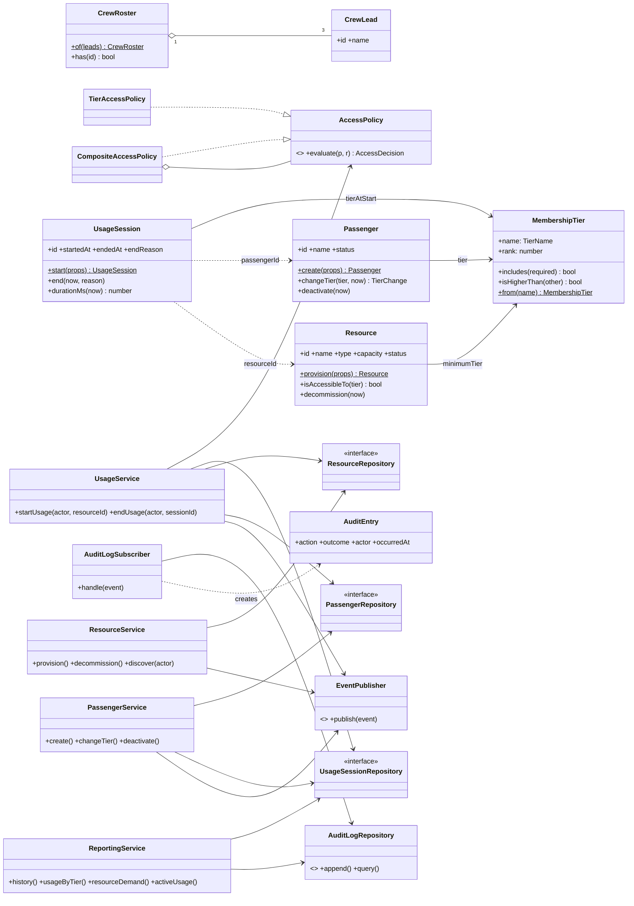
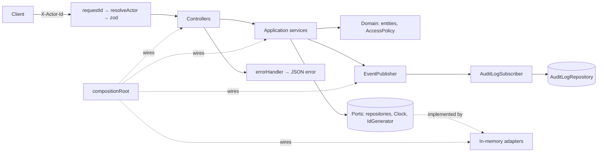

# Spaceship X26 – Passenger Resource Management System (PRMS)

Design document · v0.1 · Mathanraj Naidu

> This is the working design for the coding challenge. It's written so it can be followed during the build
> and then cut down into the README (§8). Every section marked **Assumption** is a decision the spec leaves
> open. Each one is written down so a reviewer can see the reasoning.

---

## 0. Tech stack (and why)

| Concern            | Choice                                                                      | Reason                                                                                                                                                                                                                                        |
| ------------------ | --------------------------------------------------------------------------- | --------------------------------------------------------------------------------------------------------------------------------------------------------------------------------------------------------------------------------------------- |
| Runtime / language | Node.js 24 LTS, TypeScript (`strict: true`)                                 | The company's stack. Strict types make domain rules visible in signatures.                                                                                                                                                                    |
| HTTP               | Express 5                                                                   | Familiar and minimal. v5 sends rejected async handlers to the error middleware, so no `asyncHandler` wrappers are needed.                                                                                                                     |
| Validation         | zod                                                                         | One schema per request is both the runtime check and the static type (`z.infer`).                                                                                                                                                             |
| Tests              | **Vitest** + supertest                                                      | Runs TypeScript natively (no ts-jest/babel setup), has a Jest-compatible API that reviewers can read straight away, and a fast watch mode that suits a red-green-refactor loop. Jest would also work. This choice is about lower config cost. |
| Persistence        | In-memory repositories behind interfaces                                    | The spec doesn't require a DB. The interfaces are async (`Promise<…>`), so a Postgres adapter could replace them without touching the services.                                                                                               |
| Quality gates      | ESLint, Prettier, `tsc --noEmit`, coverage threshold in CI (GitHub Actions) | "Production readiness" at low cost.                                                                                                                                                                                                           |
| Logging            | pino (+ pino-http), with a request id on every log line                     | Structured logs. Only a few lines of setup.                                                                                                                                                                                                   |

Explicitly **out of scope** (avoids overengineering): real database, real auth provider/JWT, DI container
library, message broker, websockets, event sourcing, CQRS, Docker orchestration.

---

## 1. Scope and assumptions

### 1.1 In scope (mapped to the spec)

| Level | Requirement                                 | Delivered as                                                                                             |
| ----- | ------------------------------------------- | -------------------------------------------------------------------------------------------------------- |
| 1     | Crew Lead enforcement (exactly 3)           | `CrewRoster` value object validated at boot. No API can add or remove crew leads.                        |
| 1     | Resources categorised by min tier           | `Resource.minimumTier`, defaulted from the resource type (§2.3).                                         |
| 1     | Passenger discovery (filtered list)         | `GET /me/resources` returns only active resources the passenger's tier can access.                       |
| 2     | Permission validation before use            | `AccessPolicy` is checked synchronously inside `startUsage`, together with capacity and status checks.   |
| 2     | Tier management                             | `PUT /passengers/:id/tier` (Crew Lead only), with defined behaviour on downgrade.                        |
| 2     | Audit logging of every resource interaction | Domain events → `AuditLogSubscriber` → append-only `AuditLogRepository`. Denied attempts are logged too. |
| 3     | Personal history                            | `GET /me/history`: sessions plus per-resource-type totals and a daily trend.                             |
| 3     | Aggregated reports grouped by tier          | `GET /reports/usage-by-tier`                                                                             |
| 3     | Usage analytics (high-demand resources)     | `GET /reports/resource-demand`: utilisation, peak concurrency, capacity denials, demand level.           |
| —     | "Monitor real-time activity"                | `GET /reports/active-usage` (live snapshot) and `GET /audit-log` (filterable).                           |

### 1.2 Assumptions (to confirm, then copy into the README)

1. **Actor identification.** Every request carries `X-Actor-Id: <id>`. Middleware resolves it to an
   `Actor` (`CrewLead` or `Passenger`). An unknown or missing id returns `401`. This stands in for real
   authentication (JWT/OIDC). The resolver sits behind an `ActorResolver` interface, so swapping it is a
   one-class change.
2. **Crew Leads are seeded, not created.** The three Crew Leads come from config (`CREW_LEADS` env / seed
   file) at boot. `CrewRoster.of(leads)` throws `CrewRosterInvariantError` unless there are **exactly three,
   with unique ids**, so the app fails fast and never starts in an invalid state. There is intentionally no
   endpoint to create or delete a Crew Lead. That is how "prevent unauthorized administrative expansion" is
   enforced: the operation doesn't exist. (With more time: an atomic `replaceCrewLead(old, new)` that keeps
   the count at 3.)
3. **Passengers are only created by Crew Leads** and are never hard-deleted. "Manage" means create, update
   profile (name) and deactivate. Deactivation is a soft delete, which keeps the audit and history intact.
4. **Resources have a capacity** (maximum concurrent sessions, integer ≥ 1). Usage is modelled as a
   **`UsageSession`** with a start and an end. A passenger can have **at most one active session per
   resource**, but can use several different resources at the same time.
5. **"Real-time validation"** means every start-usage request is validated synchronously against current
   state (tier, passenger status, resource status, capacity, duplicate session). Nothing is cached and
   there are no eventual-consistency windows. Live push (SSE/websockets) is out of scope.
6. **Concurrency.** Repositories are async, so two requests could interleave between "check capacity" and
   "save session". `startUsage` runs inside a small per-resource `KeyedMutex` (around 20 lines, in-house) so
   the last free slot can't be double-booked. With a real DB this would be a transaction with a row lock or
   a conditional insert.
7. **Downgrade with active sessions.** When a downgrade makes a resource inaccessible, the passenger's active
   sessions on that resource are **ended automatically** with reason `TIER_DOWNGRADED`, and each one is
   audited. Rationale: the access policy must hold at all times, not only at session start. Upgrades never
   affect sessions. Changing to the same tier returns `409 TIER_UNCHANGED`.
8. **Decommissioning a resource with active sessions is rejected** (`409 RESOURCE_IN_USE`). Rationale:
   these are life-support resources, so the system shouldn't cut someone off silently. A Crew Lead can end
   sessions explicitly (`POST /sessions/:id/end`) and then decommission. Decommission is a soft state change
   (`ACTIVE → DECOMMISSIONED`, terminal), so history and reports still resolve the resource.
   _(This is deliberately different from #7. Downgrade is an entitlement change. Decommission is an
   operational action where a human should decide.)_
9. **Deactivating a passenger** ends their active sessions (`PASSENGER_DEACTIVATED`). Inactive passengers
   can't authenticate (`401`) and can't be tier-changed (`409 PASSENGER_INACTIVE`).
10. **Sessions don't expire on their own.** They stay open until ended by the passenger or a Crew Lead.
    (Future work: TTL / max duration per resource type.)
11. **History is immutable.** Each session stores `tierAtStart`, so tier reports group usage by the tier the
    passenger held _when they used the resource_. A later downgrade doesn't rewrite history.
12. **IDs and time are injected.** `IdGenerator` (production: `crypto.randomUUID()`; tests: sequential
    `pas-1`, `res-1`…) and `Clock` (production: `SystemClock`; tests: `FakeClock` with `advance(ms)`).
    The domain never calls `Date.now()` or `randomUUID()` directly, so tests are deterministic.
13. **Base inventory** is seeded at boot (one or two of each resource type), as is an optional set of demo
    passengers (env flag), so a reviewer can try the API straight away with the curl examples in the README.
14. **Data is lost on restart** (in-memory). This is acceptable for the challenge and stated in the README.

---

## 2. Domain model

### 2.1 `MembershipTier` (value object)

```ts
export const TIERS = ['SILVER', 'GOLD', 'PLATINUM'] as const;   // order = rank
export type TierName = typeof TIERS[number];

export class MembershipTier {
  static readonly SILVER = new MembershipTier('SILVER', 1);
  static readonly GOLD = new MembershipTier('GOLD', 2);
  static readonly PLATINUM = new MembershipTier('PLATINUM', 3);
  static from(name: string): MembershipTier       // throws InvalidTierError
  includes(required: MembershipTier): boolean     // this.rank >= required.rank
  isHigherThan(other) / isLowerThan(other) / equals(other)
}
```

**Design decision:** "higher levels inherit lower-level access" is modelled as **ordering**, not class
inheritance. A `PlatinumPassenger extends GoldPassenger` hierarchy would tie a passenger's type to a value
that changes at runtime (upgrade/downgrade), so the class would have to change at runtime. A ranked value
object makes inheritance a single comparison, and adding a tier (e.g. `DIAMOND`) means adding one line.

### 2.2 Entities

| Entity                       | Fields                                                                                                                                             | Invariants / behaviour                                                                                                                                                                                                                                    |
| ---------------------------- | -------------------------------------------------------------------------------------------------------------------------------------------------- | --------------------------------------------------------------------------------------------------------------------------------------------------------------------------------------------------------------------------------------------------------- |
| `CrewLead`                   | `id`, `name`                                                                                                                                       | Immutable. Only exists inside a `CrewRoster`.                                                                                                                                                                                                             |
| `CrewRoster` (VO)            | `leads: readonly CrewLead[3]`                                                                                                                      | Exactly 3, unique ids. `has(id)`, `find(id)`.                                                                                                                                                                                                             |
| `Passenger`                  | `id`, `name`, `tier`, `status: ACTIVE \| INACTIVE`, `createdAt`, `updatedAt`                                                                       | Name 1–100 chars, trimmed. `changeTier(t, now)` throws `TierUnchangedError` if equal and `PassengerInactiveError` if inactive. Returns `{ from, to, direction }`. `deactivate(now)` throws `PassengerInactiveError` if the passenger is already inactive. |
| `Resource`                   | `id`, `name`, `type: ResourceType`, `minimumTier`, `capacity`, `status: ACTIVE \| DECOMMISSIONED`, `provisionedAt`, `decommissionedAt?`            | Capacity is an integer ≥ 1. `isAccessibleTo(tier)` returns `tier.includes(minimumTier)`. `decommission(now)` is only allowed from `ACTIVE`.                                                                                                               |
| `UsageSession`               | `id`, `passengerId`, `resourceId`, `tierAtStart`, `startedAt`, `endedAt?`, `endReason?`                                                            | `end(now, reason)` only if active and `now >= startedAt`. `durationMs(now)` uses `now` while the session is still active.                                                                                                                                 |
| `AuditEntry` (VO, immutable) | `id`, `occurredAt`, `actor {id, role}`, `action`, `outcome: SUCCESS \| DENIED`, `passengerId?`, `resourceId?`, `sessionId?`, `reason?`, `metadata` | Append-only. No update or delete anywhere in the codebase.                                                                                                                                                                                                |

`EndReason = PASSENGER_ENDED | CREW_ENDED | TIER_DOWNGRADED | PASSENGER_DEACTIVATED`

Entities are created through **static factory methods** (`Passenger.create(props, deps)`,
`Resource.provision(...)`, `UsageSession.start(...)`) that validate invariants. Constructors are private, so
an invalid entity can't be built.

### 2.3 Resource types and default tier

```ts
const DEFAULT_MINIMUM_TIER: Record<ResourceType, TierName> = {
  FOOD_STATION: 'SILVER',
  SLEEPING_POD: 'SILVER',
  BASIC_HYGIENE: 'SILVER',
  OXYGEN_REFILL: 'SILVER',
  FITNESS_CENTER: 'SILVER', // in the spec's infrastructure list, not its tier table → assumed SILVER
  PRIVATE_CABIN: 'GOLD',
  ADVANCED_MEDICAL_BAY: 'GOLD',
  LUXURY_O2_POD: 'PLATINUM',
  VIP_REC_DECK: 'PLATINUM',
};
```

When provisioning, a Crew Lead may pass an explicit `minimumTier` to override the default. This keeps the
spec's table as the source of truth while letting the crew adapt to mission needs.

### 2.4 Domain errors

```
DomainError (abstract)               code: string, message, details?
├── ValidationError                  VALIDATION_ERROR, INVALID_TIER, INVALID_CAPACITY
├── NotFoundError                    PASSENGER_NOT_FOUND, RESOURCE_NOT_FOUND, SESSION_NOT_FOUND
├── AuthenticationError              UNAUTHENTICATED (missing / unknown / inactive actor)
├── AuthorizationError               FORBIDDEN (wrong role, e.g. passenger calling crew endpoint)
├── AccessDeniedError                TIER_ACCESS_DENIED (tier too low for resource)
├── ConflictError
│   ├── CapacityExceededError        CAPACITY_EXCEEDED
│   ├── SessionAlreadyActiveError    SESSION_ALREADY_ACTIVE
│   ├── SessionAlreadyEndedError     SESSION_ALREADY_ENDED
│   ├── ResourceInUseError           RESOURCE_IN_USE
│   ├── ResourceDecommissionedError  RESOURCE_DECOMMISSIONED
│   ├── PassengerInactiveError       PASSENGER_INACTIVE
│   └── TierUnchangedError           TIER_UNCHANGED
└── InvariantViolationError          CREW_ROSTER_INVALID (boot-time; process exits non-zero)
```

The domain doesn't know about HTTP. A single map in the HTTP layer turns error classes into status codes
(§5.2). Anything that isn't a `DomainError` becomes `500 INTERNAL_ERROR` with a generic message, and the
details are only written to the log.

### 2.5 Domain events

`PassengerCreated`, `PassengerUpdated`, `PassengerDeactivated`, `PassengerTierChanged`,
`ResourceProvisioned`, `ResourceDecommissioned`, `UsageStarted`, `UsageEnded`, `UsageDenied`.

Each event carries `occurredAt`, `actor`, and the relevant ids and payload. `UsageDenied` is published
_before_ the error is thrown, so denied attempts (tier, capacity, decommissioned) are part of the audit
trail. "Every resource interaction" includes the failed ones.

---

## 3. Architecture

### 3.1 Layers (hexagonal-lite)

Dependencies point **inwards only**: `http → application → domain`. `infrastructure` implements
the ports declared in `application`. The ESLint `import/no-restricted-paths` rule enforces this.

```
src/
├── domain/                     # pure TS, no framework imports
│   ├── tier/MembershipTier.ts
│   ├── crew/CrewLead.ts, CrewRoster.ts
│   ├── passenger/Passenger.ts
│   ├── resource/Resource.ts, ResourceType.ts
│   ├── usage/UsageSession.ts
│   ├── audit/AuditEntry.ts
│   ├── access/AccessPolicy.ts, TierAccessPolicy.ts
│   ├── events/DomainEvent.ts
│   └── errors/*.ts
├── application/
│   ├── ports/                  # interfaces the app depends on
│   │   ├── PassengerRepository.ts, ResourceRepository.ts,
│   │   ├── UsageSessionRepository.ts, AuditLogRepository.ts
│   │   ├── Clock.ts, IdGenerator.ts, EventPublisher.ts, ActorResolver.ts
│   ├── auth/Actor.ts, Authorizer.ts           # role checks live here, not only in HTTP
│   ├── services/
│   │   ├── PassengerService.ts                # create/update/deactivate/changeTier
│   │   ├── ResourceService.ts                 # provision/decommission/list/discover
│   │   ├── UsageService.ts                    # start/end sessions
│   │   └── ReportingService.ts                # history, tier report, demand, active usage
│   ├── reporting/DemandClassifier.ts, peakConcurrency.ts
│   ├── subscribers/AuditLogSubscriber.ts
│   └── concurrency/KeyedMutex.ts
├── infrastructure/
│   ├── persistence/in-memory/InMemory*Repository.ts
│   ├── events/InProcessEventBus.ts
│   ├── time/SystemClock.ts   ids/UuidGenerator.ts
│   ├── config/env.ts (zod-validated)   seed/crewLeads.ts, baseInventory.ts
├── http/
│   ├── app.ts                 # createApp(deps): Express  ← no globals, testable
│   ├── routes/*.routes.ts     controllers/*.controller.ts
│   ├── schemas/*.schema.ts    # zod request schemas
│   ├── middleware/requestId.ts, resolveActor.ts, errorHandler.ts, notFound.ts
│   └── presenters/*.ts        # entity → DTO (domain objects never leak as JSON)
├── compositionRoot.ts          # wires everything; the ONLY place `new` meets concrete infra
└── server.ts                   # boot, listen, graceful shutdown (SIGTERM)
tests/
├── unit/  (domain, policy, reporting helpers)
├── application/ (services with in-memory repos + FakeClock)
├── http/  (supertest)
└── support/ FakeClock.ts, SequentialIdGenerator.ts, builders.ts (aPassenger().gold().build())
```

**Services grouped by area rather than one class per use case:** four cohesive services are easier to
navigate in a small codebase. If one grows past about 5 operations, it would be split into use-case classes.
This trade-off is noted in the README.

**DI:** constructor injection, wired by hand in `compositionRoot.ts`. No container library, since about 15
objects don't justify one. Tests build their own object graph with fakes.

### 3.2 Request flow: `POST /me/sessions` (start usage)

1. `requestId` → `resolveActor` (header → `Actor`, otherwise 401) → zod validates `{ resourceId }`
2. Controller → `usageService.startUsage(actor, resourceId)`
3. `Authorizer.requirePassenger(actor)`
4. `mutex.runExclusive(resourceId, …)`:
   load resource (404) → status check → `accessPolicy.evaluate(passenger, resource)` →
   duplicate-session check → capacity check (`countActive(resourceId) < capacity`) →
   `UsageSession.start(...)` → `sessions.save()`
5. Publish `UsageStarted`, or `UsageDenied{reason}` followed by a throw → `AuditLogSubscriber` appends the entry
6. Presenter → `201 { session }`. Errors → `errorHandler` → consistent shape.

### 3.3 SOLID: where each principle actually shows up

| Principle | Concrete place in the code                                                                                                                                                                                                                                                         |
| --------- | ---------------------------------------------------------------------------------------------------------------------------------------------------------------------------------------------------------------------------------------------------------------------------------- |
| **S**RP   | `Passenger` enforces its own invariants. `TierAccessPolicy` only decides access. `AuditLogSubscriber` only records events. Controllers only translate HTTP ↔ service calls. Presenters only shape JSON.                                                                            |
| **O**CP   | New access rules (e.g. a medical-emergency override) are new `AccessPolicy` implementations combined in `CompositeAccessPolicy`, with no edits to `UsageService`. New side effects (metrics, notifications) are new event subscribers. A new tier is one line in `MembershipTier`. |
| **L**SP   | `InMemoryPassengerRepository` and a future `PostgresPassengerRepository` both pass the **same shared contract test suite** (`describeRepositoryContract(factory)`), which is a concrete check of substitutability. `FakeClock`/`SystemClock` are interchangeable.                  |
| **I**SP   | Repositories expose only what callers need. `AuditLogRepository` has `append` and `query`, and **no update/delete**, so immutability is enforced by the type. Reporting depends on a read-only `UsageSessionReader`, not the full repository.                                      |
| **D**IP   | Services depend on `ports/*` interfaces. Concrete classes are only instantiated in `compositionRoot.ts`. `createApp(deps)` takes its dependencies as parameters, which is what makes supertest tests possible without globals.                                                     |

### 3.4 Design patterns (only where they earn their place)

| Pattern                              | Where                                                                                                         | Why it's justified here                                                                                                                                                                                                                                                         |
| ------------------------------------ | ------------------------------------------------------------------------------------------------------------- | ------------------------------------------------------------------------------------------------------------------------------------------------------------------------------------------------------------------------------------------------------------------------------- |
| **Repository**                       | `ports/*Repository` + in-memory adapters                                                                      | Keeps persistence swappable and keeps services testable. It's the reason "no DB" is an acceptable trade-off.                                                                                                                                                                    |
| **Strategy / Policy**                | `AccessPolicy.evaluate(passenger, resource): AccessDecision` → `TierAccessPolicy` (+ `CompositeAccessPolicy`) | Access control is the core business rule. It's isolated, unit-testable as a truth table, and extensible. It returns a decision with a reason (no boolean-only result), which feeds the audit log and the error message.                                                         |
| **Observer (domain events)**         | `EventPublisher` → `InProcessEventBus` → `AuditLogSubscriber`                                                 | Audit is a cross-cutting concern. Without events, every service method would need its own `audit.append(...)` call, and one could be forgotten. Publishing is **synchronous and awaited**, so the audit entry exists before the response is sent (reliability over decoupling). |
| **Factory (static factory methods)** | `Passenger.create`, `Resource.provision`, `UsageSession.start`, `CrewRoster.of`, `createApp(deps)`            | Validates at construction, so invalid objects can't exist. `createApp` is an app factory for tests.                                                                                                                                                                             |
| **Composition Root**                 | `compositionRoot.ts`                                                                                          | One place where the object graph is wired. Swapping an adapter is a single-line change.                                                                                                                                                                                         |
| **Presenter / DTO mapper**           | `http/presenters`                                                                                             | Domain objects are never serialised directly, so internal changes don't break the API contract.                                                                                                                                                                                 |

Considered and **rejected**: DI container (too much for this size), CQRS/event sourcing (not needed, and it
would hurt readability), generic `BaseRepository<T>` (encourages wide interfaces and goes against ISP),
class inheritance for tiers (§2.1).

---

## 4. Diagrams

### 4.1 Class diagram (domain + application core)



### 4.2 Component view



---

## 5. REST API

Base path `/api/v1`. JSON only. Auth header `X-Actor-Id`. **CL** = Crew Lead, **P** = Passenger.
Lists support `?limit=&offset=` (default 50, max 200) and return `{ data: [...], page: { limit, offset, total } }`.
Common errors on every authenticated route: `401 UNAUTHENTICATED`, `403 FORBIDDEN` (wrong role), `400 VALIDATION_ERROR`.

### 5.1 Endpoints

| Method | Path                          | Actor | Purpose                                                                                                                                              | Main errors (beyond common)                                                                                         |
| ------ | ----------------------------- | ----- | ---------------------------------------------------------------------------------------------------------------------------------------------------- | ------------------------------------------------------------------------------------------------------------------- |
| GET    | `/health`                     | none  | Liveness                                                                                                                                             | –                                                                                                                   |
| GET    | `/crew-leads`                 | CL    | List the 3 crew leads                                                                                                                                | –                                                                                                                   |
| POST   | `/passengers`                 | CL    | Create passenger `{ name, tier }`                                                                                                                    | 400 `INVALID_TIER`                                                                                                  |
| GET    | `/passengers`                 | CL    | List, filter `?tier=&status=`                                                                                                                        | –                                                                                                                   |
| GET    | `/passengers/:id`             | CL    | Get profile                                                                                                                                          | 404                                                                                                                 |
| PATCH  | `/passengers/:id`             | CL    | Update profile `{ name }`                                                                                                                            | 404, 409 `PASSENGER_INACTIVE`                                                                                       |
| PUT    | `/passengers/:id/tier`        | CL    | Upgrade/downgrade `{ tier }` → returns `{ passenger, change, endedSessions[] }`                                                                      | 404, 409 `TIER_UNCHANGED`, 409 `PASSENGER_INACTIVE`                                                                 |
| POST   | `/passengers/:id/deactivate`  | CL    | Soft-deactivate, ends active sessions                                                                                                                | 404, 409 `PASSENGER_INACTIVE`                                                                                       |
| GET    | `/passengers/:id/history`     | CL    | A passenger's history (same shape as `/me/history`)                                                                                                  | 404                                                                                                                 |
| POST   | `/resources`                  | CL    | Provision `{ name, type, capacity, minimumTier? }`                                                                                                   | 400 `INVALID_CAPACITY`                                                                                              |
| GET    | `/resources`                  | CL    | Full inventory, filter `?status=&minimumTier=&type=`                                                                                                 | –                                                                                                                   |
| GET    | `/resources/:id`              | CL    | Resource + current occupancy                                                                                                                         | 404                                                                                                                 |
| POST   | `/resources/:id/decommission` | CL    | Retire resource                                                                                                                                      | 404, 409 `RESOURCE_IN_USE`, 409 `RESOURCE_DECOMMISSIONED`                                                           |
| GET    | `/me`                         | P     | Own profile                                                                                                                                          | –                                                                                                                   |
| GET    | `/me/resources`               | P     | **Discovery:** active resources accessible to own tier, with `availableSlots`                                                                        | –                                                                                                                   |
| POST   | `/me/sessions`                | P     | **Start usage** `{ resourceId }`                                                                                                                     | 404, 403 `TIER_ACCESS_DENIED`, 409 `CAPACITY_EXCEEDED`, 409 `SESSION_ALREADY_ACTIVE`, 409 `RESOURCE_DECOMMISSIONED` |
| GET    | `/me/sessions`                | P     | Own sessions `?status=active\|ended`                                                                                                                 | –                                                                                                                   |
| POST   | `/me/sessions/:id/end`        | P     | End own session                                                                                                                                      | 404 (also for other people's sessions, so ids don't leak), 409 `SESSION_ALREADY_ENDED`                              |
| GET    | `/me/history`                 | P     | Personal history + totals per resource type + daily trend `?from=&to=`                                                                               | 400 invalid range                                                                                                   |
| POST   | `/sessions/:id/end`           | CL    | End any session (reason `CREW_ENDED`)                                                                                                                | 404, 409 `SESSION_ALREADY_ENDED`                                                                                    |
| GET    | `/reports/active-usage`       | CL    | Live snapshot: occupancy per resource, active sessions                                                                                               | –                                                                                                                   |
| GET    | `/reports/usage-by-tier`      | CL    | Per tier: passenger count, sessions, total duration, top resources `?from=&to=`                                                                      | 400 invalid range                                                                                                   |
| GET    | `/reports/resource-demand`    | CL    | Per resource: sessions, total duration, current & peak utilisation, capacity denials, `demandLevel` (HIGH/NORMAL/LOW), sorted by demand `?from=&to=` | 400 invalid range                                                                                                   |
| GET    | `/audit-log`                  | CL    | Filter `?passengerId=&resourceId=&action=&outcome=&from=&to=`                                                                                        | –                                                                                                                   |

Design notes:

- **Separate `/me/*` routes for passengers** rather than one `/resources` route whose response changes by
  role. The contract per actor is explicit, and authorization is easier to reason about and test.
- State transitions (`deactivate`, `decommission`, `end`) are `POST` sub-resources, not `DELETE`, because
  nothing is actually deleted.
- **Demand classification** (`DemandClassifier`, thresholds from config): `HIGH` if peak utilisation
  ≥ 80% **or** capacity denials ≥ 3 in the window; `LOW` if peak utilisation < 20%; otherwise `NORMAL`. Peak
  concurrency is computed with a sweep over session start and end events. It's a small pure function with
  its own unit tests.

### 5.2 Error response shape and HTTP mapping

```json
{
  "error": {
    "code": "TIER_ACCESS_DENIED",
    "message": "Passenger tier SILVER cannot access resource 'Luxury O2 Pod A' (requires PLATINUM).",
    "details": { "requiredTier": "PLATINUM", "passengerTier": "SILVER" },
    "requestId": "7f2c…"
  }
}
```

| Error class                                                     | HTTP                                                       |
| --------------------------------------------------------------- | ---------------------------------------------------------- |
| `ValidationError` (incl. zod failures, with `details.issues[]`) | 400                                                        |
| `AuthenticationError`                                           | 401                                                        |
| `AuthorizationError`, `AccessDeniedError`                       | 403                                                        |
| `NotFoundError` (and unknown routes)                            | 404                                                        |
| `ConflictError` subclasses                                      | 409                                                        |
| Malformed JSON body                                             | 400 `MALFORMED_JSON`                                       |
| Anything else                                                   | 500 `INTERNAL_ERROR` (generic message; stack only in logs) |

Success codes: `201` on create/start (with a `Location` header), `200` otherwise.

---

## 6. Test strategy

**TDD loop:** each behaviour starts as a failing test (red), gets the minimum code to pass (green), then a
refactor. The domain and policy code are written fully test-first. HTTP tests come after the service works.

| Layer               | Tooling                                                                                 | What                                                                                                                                                                                                  | Rough share |
| ------------------- | --------------------------------------------------------------------------------------- | ----------------------------------------------------------------------------------------------------------------------------------------------------------------------------------------------------- | ----------- |
| Unit: domain        | Vitest                                                                                  | `MembershipTier` ordering, `CrewRoster` invariant, entity factories and transitions, `TierAccessPolicy` **truth table** (`it.each` over 3 tiers × 3 min-tiers), `DemandClassifier`, `peakConcurrency` | ~50%        |
| Application         | Vitest + in-memory repos + `FakeClock` + `SequentialIdGenerator` + spy `EventPublisher` | Each service operation: success path, authorization, every error branch, emitted events/audit entries, report aggregation                                                                             | ~35%        |
| Repository contract | Shared suite run against every adapter                                                  | save/find/query semantics (LSP check)                                                                                                                                                                 | small       |
| HTTP integration    | supertest on `createApp(testDeps)`                                                      | Wiring, status codes, error shape, actor header handling, zod validation, one end-to-end "story" test per level                                                                                       | ~15%        |

Coverage gate: ≥ 90% lines/branches on `domain` and `application` (enforced in CI). The HTTP glue isn't
chased for coverage.

### Key edge cases (each one gets a named test)

**Crew / auth**

- Boot fails with 2, 4, or duplicate-id crew leads. Succeeds with exactly 3.
- Missing, unknown, or inactive-passenger `X-Actor-Id` returns 401. Passenger calling a CL endpoint returns 403. CL calling `/me/*` returns 403.

**Tiers and access**

- Truth table: SILVER→only SILVER resources. GOLD→SILVER and GOLD. PLATINUM→all.
- Discovery excludes decommissioned resources and higher-tier resources. An empty result is `[]`, not an error.
- Invalid tier string returns 400. Same-tier change returns 409. Change on an inactive passenger returns 409.
- Downgrade PLATINUM→SILVER ends sessions on GOLD and PLATINUM resources only, keeps SILVER sessions, and audits each ended session.
- Upgrade gives immediate access to newly unlocked resources (validation is real-time, nothing cached).

**Usage sessions**

- Start on a resource above your tier returns 403 **and writes a DENIED audit entry**.
- Capacity: the Nth+1 start returns 409. After one session ends, a start succeeds again.
- **Concurrency:** `Promise.all` of 5 starts on a capacity-1 resource gives exactly 1 success and 4 `CAPACITY_EXCEEDED` (proves the mutex works).
- Same passenger, same resource, twice returns 409 `SESSION_ALREADY_ACTIVE`. A different resource is allowed.
- Ending an already-ended session returns 409. Ending another passenger's session returns 404.
- Start on a decommissioned or non-existent resource returns 409 / 404.
- Duration is computed with `FakeClock` (an active session's duration grows as the clock advances).

**Resources**

- Capacity 0, negative, non-integer, or missing returns 400. Unknown type returns 400. `minimumTier` override is respected.
- Decommission with active sessions returns 409. Decommission twice returns 409. History still resolves a decommissioned resource.

**Reporting**

- Tier report uses `tierAtStart` (usage before a downgrade stays under the old tier).
- Empty dataset returns zeroed groups for all 3 tiers (stable shape).
- `from > to` returns 400. Window boundaries are inclusive/exclusive as documented.
- Demand: a resource at 100% peak with denials is HIGH. An idle resource is LOW. Sort order is stable.

**HTTP**

- Malformed JSON returns 400 `MALFORMED_JSON`. Unknown route returns 404 in the standard shape. A 500 never leaks a stack trace.

---

## 7. Build order (TDD commits that tell a story)

One commit per green step (test + implementation together, so every commit builds and passes). Refactors
go in separate `refactor:` commits. Roughly 30–35 commits.

**Setup**

1. `chore: initialise TypeScript project with strict tsconfig, ESLint, Prettier`
2. `chore: add Vitest with coverage thresholds and npm scripts`
3. `ci: add GitHub Actions workflow (lint, typecheck, test)`
4. `docs: add design document`

**Level 1: Basic passenger and resource management** 5. `feat(domain): add MembershipTier value object with rank-based inheritance` 6. `feat(domain): add CrewRoster enforcing exactly three unique crew leads` 7. `feat(domain): add domain error hierarchy` 8. `feat(domain): add Passenger entity with validated factory` 9. `feat(domain): add Resource entity with type-based default minimum tier` 10. `feat(domain): add TierAccessPolicy with full tier truth-table tests` 11. `feat(app): add repository ports and in-memory adapters with shared contract tests` 12. `feat(app): add Clock and IdGenerator ports with test doubles` 13. `feat(app): add Authorizer and PassengerService.create for crew leads` 14. `feat(app): add ResourceService provisioning and passenger discovery` 15. `feat(http): add createApp, actor resolution middleware and error handler` 16. `feat(http): expose passenger, resource and discovery endpoints with zod validation` 17. `feat: seed crew leads and base inventory at boot; fail fast on invalid roster`

**Level 2: Dynamic access and validation** 18. `feat(domain): add UsageSession entity with start/end lifecycle` 19. `feat(app): start usage with real-time tier, status and capacity validation` 20. `feat(app): serialise session starts per resource to prevent double-booking` 21. `feat(app): end usage sessions for passengers and crew leads` 22. `feat(domain): add domain events and in-process event bus` 23. `feat(app): record audit entries for all resource interactions, including denials` 24. `feat(app): upgrade/downgrade tiers and end newly-inaccessible sessions on downgrade` 25. `feat(app): deactivate passengers and decommission resources with in-use guard` 26. `feat(http): expose session, tier, lifecycle and audit-log endpoints` 27. `refactor: extract presenters to decouple API DTOs from entities`

**Level 3: Advanced reporting and insights** 28. `feat(app): personal usage history with per-type totals and daily trend` 29. `feat(app): usage report grouped by tier at time of use` 30. `feat(reporting): compute peak concurrency via sweep-line` 31. `feat(reporting): classify resource demand with configurable thresholds` 32. `feat(app): active usage snapshot for real-time monitoring` 33. `feat(http): expose reporting endpoints` 34. `test(http): add end-to-end mission scenario covering all three levels`

**Finish** 35. `feat: structured logging, request ids and graceful shutdown` 36. `docs: README with setup, API examples, assumptions, trade-offs and AI disclosure`

Tip: tag `level-1`, `level-2`, `level-3` at the end of each group so reviewers can check out each stage.

---

## 8. README outline

1. **Overview**: what PRMS does, in 3 lines.
2. **Quick start**: `nvm use`, `npm ci`, `npm test`, `npm run dev`. Seeded crew lead ids and demo passenger ids.
3. **API walkthrough**: about 6 curl examples (discover → start → denied → downgrade → report).
4. **Architecture**: folder map, layer rule, the component diagram, request-flow summary.
5. **Design decisions**: tier as an ordered value object, Strategy access policy, events for audit, `/me` routes, sessions with capacity.
6. **Assumptions**: the list from §1.2.
7. **Trade-offs**: in-memory store, header auth, synchronous event bus, services by area vs use-case classes, mutex vs DB locking.
8. **Testing**: pyramid, how to run, coverage, notable edge-case tests.
9. **What I'd improve with more time**: §9.
10. **AI usage disclosure** (template):

```markdown
## AI Usage Disclosure

**Tools used:** <e.g. tool name(s) and version/plan>

**How I used them**

- Design: <e.g. compared the two challenges, then drafted and critiqued the domain model and API; I made the final calls on X, Y, Z>
- Implementation: <e.g. autocomplete / generating test scaffolding / boilerplate (Express wiring, zod schemas)>
- Review: <e.g. asked for edge cases I might have missed; asked for a review of the diff before each level>

**AI-assisted portions**

| Area                      | Level of assistance | Notes                        |
| ------------------------- | ------------------- | ---------------------------- |
| Design doc / architecture | <high/medium/low>   | <what I changed or rejected> |
| Domain & services         | <…>                 | <…>                          |
| Tests                     | <…>                 | <…>                          |
| README                    | <…>                 | <…>                          |

**What I did myself / verified**

- Every line was reviewed, run and tested by me. All tests were written red → green.
- Decisions I made against AI suggestions: <e.g. rejected a DI container; changed decommission to reject when in use>

**Example prompts / workflow (optional)**

- "<prompt>" → <what I kept / changed>
```

---

## 9. What I'd do with more time

- Postgres adapter (e.g. Kysely/Prisma) that passes the existing repository contract suite, with transactional capacity checks instead of the in-process mutex.
- Real authentication (JWT/OIDC) behind the existing `ActorResolver`, plus rate limiting on session starts.
- Live activity stream (SSE) for Crew Leads, fed by the same event bus.
- Atomic crew-lead replacement (`replaceCrewLead`) that keeps the roster at exactly 3, with dual-approval.
- Session TTL / max duration per resource type, and a reservation/queue for HIGH-demand resources.
- Transactional outbox for audit entries once there's a real DB (audit and state change committed together).
- OpenAPI spec generated from the zod schemas (`zod-to-openapi`) with Swagger UI.
- Capacity changes on live resources (reject if below current occupancy), and a resource maintenance state.
- Metrics (Prometheus) and a Dockerfile and docker-compose for one-command review.
